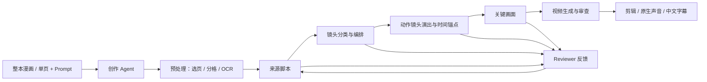

<div align="center">

# MangaWeaver

**From Manga Panels to Coherent Animation**

从离散漫画分镜，到连贯动画。

镜头编排 · Creator / Reviewer 协作 · 可编辑创作画布

[快速开始](#快速开始) · [工作原理](#工作原理) · [使用文档](#使用文档) · [演示视频](docs/media/mangaweaver-demo.mp4)

</div>


> 开发中的本地漫画转动画工作台。基于现有图像和视频模型，将漫画页组织为动画镜头，并通过创作与审查循环逐步生成关键画面和有声短片。

## 为什么做 MangaWeaver

漫画格经常表现动作的高潮或结果，而不是动作的起始帧。直接把每格作为首帧生成视频，容易得到“静态漫画动起来”的效果，也容易丢失镜头节奏。

MangaWeaver 在生成前增加镜头编排：结合多个漫画格理解事件，把它们组织成静态或动作镜头，确定入点、原作关键瞬间、出点及镜头时长。重点是让漫画的叙事转化为动画的时间呈现。

## 当前能做什么

- **整本与单页导入**：支持 MOBI、PDF、CBZ 和图片；书籍首次先处理前 10 页，后续按需选页。
- **漫画预处理**：MAGI 分格、阅读排序，以及显式选择的本地 OCR；支持人工校对来源与对白。
- **创作 Agent**：接收要求、选择漫画页、委派阶段任务、引用画布对象并定位产物。
- **Creator / Reviewer 循环**：脚本、镜头编排、演出和关键画面按阶段创作、审查与修订，保留实际过程。
- **节点画布**：漫画原页、有序单格、镜头规划、关键画面和视频逐步出现；支持分组折叠、缩放和详情编辑。
- **有声短片**：目标为彩色二维动画、日语对白与中文字幕，剪辑保留视频模型原生音轨。
- **本地恢复**：保存会话、任务 ID、中间产物和审查记录；支持停止本地执行及显式恢复。
- **桌面素材库**：主动导入漫画，首页选材，查看并继续已有成片。

### 演示与验证范围

[查看／下载真实生成视频](docs/media/mangaweaver-demo.mp4)（约 13.4 秒）。视频来自已有测试产物，不是静帧模拟。它用于展示流程，仍存在镜头、口型与连续性上的质量限制。

桌面已有真实付费链路测试及本地交互检查；最近前端构建和 22 项已有检查通过。完整动画质量、多窗口布局、个别片段在客户端的播放以及默认 Lite／480P 路线尚不能视为全面验收通过。具体证据见[付费客户端记录](docs/PAID_CLIENT_VALIDATION_2026-10-28.md)和[最近视觉复核](docs/WORKBENCH_VISUAL_VALIDATION_2026-11-02.md)。

## 工作原理



创作 Agent 负责用户意图、任务委派和有限画布操作。阶段内 Creator／Reviewer 负责专业创作与审查；文件读取、下载和拼接是确定性工具。图中的审查反馈按问题归属返回对应阶段，不要求每次从头生成。

静态镜头采用首帧生成；动作镜头采用相邻关键帧的首尾帧接续。漫画格与输出镜头保留多对多来源映射。整张故事板参考生成目前是独立对照实验，不是默认正式入口。

桌面采用 **Electron + React + TypeScript + Vite + React Flow**，通过受限 IPC 与 JSONL 子进程连接 Python 引擎。产物保存在本地文件中，无需额外数据库或 HTTP 服务。

## 快速开始

需要 Python 3.12+、uv、Node.js／npm，以及可执行的 FFmpeg 和 ffprobe。当前桌面主要在 macOS 上验证。

```sh
git clone https://github.com/link-wind/MangaWeaver.git
cd MangaWeaver
uv venv --python 3.12
uv pip install -e .
cp .env.example .env
```

自动分格、中文 OCR 和整本漫画导入按需安装：

```sh
uv pip install -e '.[preprocessing,local-ocr,book-import]'
```

启动桌面：

```sh
cd desktop
npm ci
npm run dev
```

首次进入左下角设置，选择项目根目录、Python、FFmpeg 和本地环境文件。首页添加漫画或从素材库选择，输入改编要求；进入画布后选择页面和制作终点，再启动制作。查看与浏览不会自动提交生成任务。

无需模型凭据即可通过首页加号菜单的“体验本地示例”检查节点逐步出现、停止和继续；它使用预设内容与静帧，不代表 AI 动画质量。

### 模型与费用

`.env.example` 列出渠道、模型与生成参数。规划／评审、图像、视频可显式配置独立凭据；真实生成需要对应 API 权限和余额，订阅会员不等同于 API 额度。

当前本地配置使用幻灵渠道的 Gemini 规划／评审、GPT Image 生图和 MiniMax H3 视频。默认代码仍保留 H3 Lite／480P；已测试渠道拒绝 Lite，仅允许标准 H3 时必须显式配置标准模型与其支持的分辨率。不会自动换模型。接口列出的模型名称不代表已经实际验证可用。

部分视频渠道要求公开 HTTPS 图像，使用临时图床意味着相关生成关键帧会上传第三方。请在配置和启动前确认所用渠道；密钥只存本机 `.env`，不要提交到仓库。

### CLI

```sh
.venv/bin/mangaweaver --help
.venv/bin/mangaweaver preprocess --manifest examples/cross-panel/source.json --run-dir results/example
.venv/bin/mangaweaver generate --plan examples/cross-panel/production.json --run-dir results/example --dry-run
```

`--dry-run` 只验证任务，不调用生成模型。完整命令、有限重试与恢复规则见[引擎指南](docs/ENGINE_GUIDE.md)。

## 项目结构

```text
src/mangaweaver/
├── agent/          # 创作会话、任务委派与工具
├── preprocessing/  # 导入、分格、OCR、角色描述
├── planning/       # 脚本、编排、演出与分镜审查
├── generation/     # 任务、视频审查、声音字幕与组装
├── clients/        # 显式模型渠道
└── cli.py          # 命令行入口
desktop/            # Electron + React 工作台
prompts/            # 分阶段创作与审查提示词
examples/           # 可分发的原创协议示例
docs/               # 架构、使用与验证记录
openspec/           # 变更规划与任务
```

## 后续方向

- 当前重点：稳定单页／小场景制作，改善节奏、视线、关键瞬间位置与桌面交互。
- 后续研究：长篇镜头组织、历史条件生成与连续性审查。
- **Hierarchical Planning · History-Conditioned Generation · Continuity-Aware Refinement** 是研究方向描述；长程历史记忆、latent prefix 与长视频一致性尚未实现或完成验证。

## 使用文档

- [项目目标](PROJECT_GOALS.md) · [架构讨论](docs/ARCHITECTURE_DRAFT.md)
- [桌面使用](docs/DESKTOP.md) · [创作 Agent](docs/CREATIVE_AGENT.md) · [Agent 运行时](docs/AGENT_RUNTIME.md)
- [本地预处理](docs/LOCAL_PREPROCESSING.md) · [画布工作流](docs/CANVAS_WORKFLOW.md)
- [声音与字幕](docs/H3_PROMPTS.md) · [协议示例](examples/README.md)
- [参考实现与第三方说明](docs/REFERENCE.md) · [演示素材说明](docs/media/README.md)

## 致谢与授权

以 [Manga2Animate](https://github.com/annchenn/Manga2Animate) 的三阶段流程和 Creator／Reviewer 思路为主要参考；参考提交与接入方式记录在 `docs/REFERENCE.md`。会话设计另参考 [Toonflow-app](https://github.com/HBAI-Ltd/Toonflow-app)，界面设计参考 MiniMax Design、AFFiNE 和 Lobe UI。

演示使用《入间同学入魔了！》测试素材，相关漫画角色、原作画面和作品权利属于各自权利人；本仓库不附完整漫画。演示文件与源码授权分开，公开展示不代表拥有原作版权。源码当前尚未指定开源许可证（桌面包声明为 UNLICENSED）；依赖及参考项目遵守各自许可。
