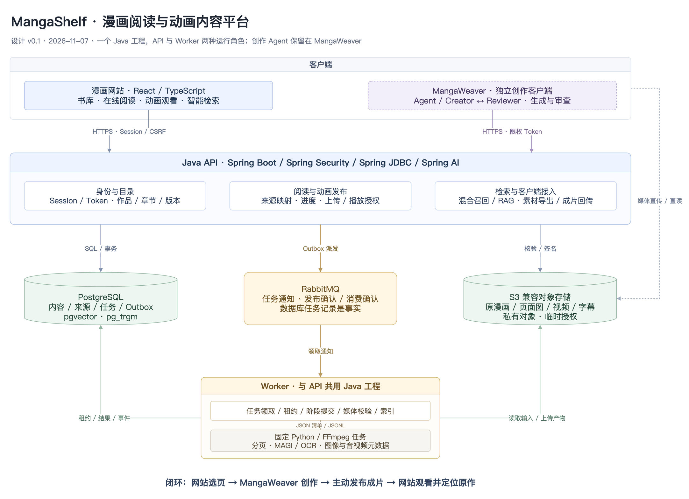
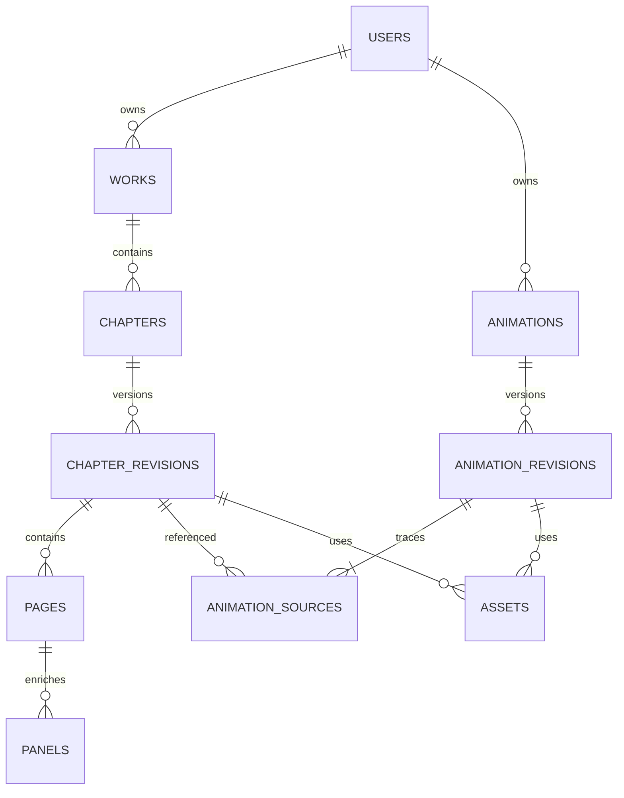

# 漫画阅读与动画内容平台：详细设计 v0.1

> 日期：2026-11-07<br>
> 工作名称：MangaShelf，正式名称、域名和仓库名待定。<br>
> 状态：独立新项目的设计草案，不代表功能已经实现。<br>
> 文档位置：暂存于 MangaWeaver 仓库，创建新仓库后可整体迁移本目录。<br>
> 范围：产品、Java 后端、数据关系、异步处理、媒体发布、检索、接入协议与实施验收。

阅读建议：先看第 1～6 节确认产品和边界，第 8～17 节作为后端实施依据，第 21～23 节用于验收、排期和简历成果整理。

## 1. 项目定位与已确认需求

### 1.1 一句话定位

**一个支持阅读漫画、观看对应改编动画、按剧情查找内容的 Web 平台，通过开放 API 与 MangaWeaver 连接，形成素材获取、动画创作和成片发布的闭环。**

网站需要独立成立：没有安装 MangaWeaver 的读者，也可以浏览漫画、阅读章节、观看动画、收藏作品并保存进度。

### 1.2 已确认与本稿建议

| 类别 | 内容 |
| --- | --- |
| 已确认 | 新项目独立于 MangaWeaver，以 Java 为主要后端语言 |
| 已确认 | 网站支持漫画阅读和漫画改编动画观看 |
| 已确认 | MangaWeaver 能接入网站素材，并将成片发布回网站 |
| 已确认 | 项目需要体现实际后端能力，适合作为独立简历项目 |
| 本稿建议 | 模块化单体、PostgreSQL、S3 兼容存储、RabbitMQ、Spring AI |
| 本稿建议 | 先支持页面范围级来源映射，精确时间轴映射后置 |
| 待验证 | 具体依赖版本、模型渠道、Embedding 模型、部署规格、性能目标 |

本稿不改变 MangaWeaver 已有的 Agent、生成模型和桌面运行机制。新网站的服务与数据库属于独立项目，不是把现有桌面引擎改成 Web 服务。

### 1.3 两个项目的边界

| 系统 | 承担职责 | 数据的主要归属 |
| --- | --- | --- |
| MangaShelf | 内容管理、阅读、播放、书架、搜索、权限、发布 | 漫画发布版本、动画内容、媒体资产、用户进度 |
| MangaWeaver | 创作对话、镜头规划、Creator／Reviewer、图像和视频生成 | 创作会话、运行记录、审查反馈、本地中间产物 |
| 接入协议 | 读取素材、传递来源、上传成片、确认发布 | 平台来源 ID、素材摘要、发布 ID、客户端运行引用 |

网站不负责执行动画生成；不会因用户打开页面、搜索或播放而自动调用视频生成模型。

## 2. 产品目标与非目标

### 2.1 核心目标

1. **能读**：上传漫画后形成稳定有序的章节和页面，支持在线阅读与继续阅读。
2. **能看**：对应动画有独立观看页，并与原漫画双向关联。
3. **能发布**：MangaWeaver 可以主动导入素材、发布成片，失败时不展示不完整内容。
4. **能检索**：通过标题、对白和剧情描述定位内容，找到页面及关联动画。
5. **可解释**：改编来源、处理状态、失败原因与发布版本都可追踪。

### 2.2 第一版不做

- 站内云端视频生成、在线镜头编辑器、第二套总 Agent。
- 评论社区、弹幕、积分、会员付费、推荐算法和复杂排行榜。
- 自动采集第三方漫画、自动从文件名推断完整章节体系。
- 多级组织、复杂协作权限、通用工作流引擎或插件体系。
- 多清晰度自适应转码、直播、DRM 和完整媒体分发平台。
- 全站事件溯源、分布式事务框架和为未知流量预建微服务。
- 双页对照或强制漫画／视频并排阅读。

这些是范围约束，不是未来必须增加的待办。

## 3. 用户、权限与可见性

### 3.1 用户身份

| 身份 | 能力 |
| --- | --- |
| 访客 | 浏览、阅读和观看公开内容 |
| 登录用户 | 使用书架、保存进度、上传自己的素材、管理自己的动画 |
| 管理员 | 管理站点内容、处理违规内容、检查失败任务 |

第一版不单独创建“创作者账户体系”：登录用户可以管理自己的内容。是否允许普通用户将内容公开，由站点配置决定；演示部署可以仅允许管理者公开发布。

### 3.2 简单可见性模型

- `PRIVATE`：所有者及管理员可访问。
- `PUBLIC`：在发布状态有效时所有人可访问。
- 章节继承作品的可见性，首版不设章节级 ACL。
- 动画有自己的可见性，但公开发布前，全部来源必须允许公开访问；私人原作的派生图和剧情摘要不会随公开动画泄漏。
- 首版接入闭环仅支持发布者自己管理的原作。公开可读不等于取得向该作品发布改编内容的权限；其他用户的改编授权作为后续明确需求处理。
- 管理员跨用户访问使用明确的管理接口，不通过普通接口暗中绕过。

所有权、可见性、发布状态必须一起判断。已上传文件不等于已公开发布。

### 3.3 权限覆盖范围

同一规则覆盖：列表、详情、页面清单、图片签名、视频签名、检索、问答引用、外部 API 和素材导出。

搜索必须在有权访问的内容范围内召回；返回和生成回答前再核验有效权限。不能先检索全库，再仅在前端隐藏结果。

已签发媒体 URL 的访问权限受有效期限制，撤销发布后通常不能瞬间使所有已签发 URL 失效。首版用短期签名并明确该边界；不承诺收回用户已经下载的文件。

## 4. 页面与主要交互

本节是页面职责设计，不是已批准的视觉稿。

| 页面 | 主要内容 | 核心操作 |
| --- | --- | --- |
| 首页／书库 | 漫画封面、简介、分类、是否有动画 | 搜索、打开作品、加入书架 |
| 我的书架 | 收藏、最近阅读、最近观看 | 继续阅读、继续观看、取消收藏 |
| 漫画详情 | 简介、章节目录、关联动画 | 阅读章节、观看动画、查看来源 |
| 漫画阅读器 | 单章页面、目录、进度 | 跳页、续读、打开关联动画 |
| 动画观看页 | 播放器、简介、字幕、原作链接 | 播放、续播、跳回原漫画 |
| 搜索结果 | 作品、剧情片段、漫画位置、关联动画 | 定位原页、观看、展开上下文 |
| 我的素材 | 上传记录、章节草稿、处理进度 | 上传、确认页序、发布、重跑失败阶段 |
| 动画管理 | 发布草稿、已发布版本、失败原因 | 上传、确认来源、发布、换版、下架 |
| 个人设置 | 登录信息、接入 Token | 创建、查看权限、撤销 Token |

### 4.1 阅读与播放的互相跳转

- 漫画页存在已发布动画时，显示“观看这段动画”，不自动播放。
- 一段动画可以覆盖多页；相关页面指向同一内容，不重复创建视频记录。
- 观看页显示来源作品、章节和页码范围，并提供回到原作的入口。
- 切换前保存阅读或播放位置；返回后恢复用户原来的位置。
- 暂时没有可靠的秒级来源映射时，只定位页面范围，不伪造逐格同步。
- 若有多个改编版本，显示可选择的动画列表，不自动认定最新上传者为正式版。

### 4.2 整本漫画的导入体验

用户创建作品后，为某个章节上传图片或 CBZ。一个 CBZ 默认是一个待整理的章节；包含整卷的文件允许先作为单个草稿章节导入，再人工划分，不能自动声称识别了原作章节。

上传后先展示页数、缩略图和顺序，用户确认再发布。缩略图和页面清单分页请求，不一次加载整本原图。

### 4.3 原作来源消失时

来源被设为私人或下架后，关联公开动画应在读取和播放授权时检查依赖；不再满足发布条件的动画停止对外展示。关联记录保留供所有者处理。

漫画发布新版本不等于撤销旧版本：原有动画继续引用原版本，并明确标注。阅读当前版本时不凭相同页码猜测对应关系。

## 5. 核心业务闭环

### 5.1 网站端

创建作品 → 上传章节 → 解析分页 → 检查页序 → 发布漫画 → 阅读／搜索。

基础阅读可在分页和图片校验完成后发布，不要求等待 OCR、摘要或向量索引完成。索引失败不会令已经可读的漫画下架。

### 5.2 MangaWeaver 端

连接平台 → 浏览或搜索素材 → 主动选择章节／页面 → 导入本地 → 创作与审查 → 选择成片 → 上传发布草稿 → 用户确认发布。

网站不向客户端下发任意工具指令，也不自动启动生成。MangaWeaver 的生成模型 Key 不传给网站。

### 5.3 读者端

阅读第 94 页 → 发现相关动画 → 观看 → 返回原作或继续阅读。

读者面对内容而不是生成日志。具体用了多少 Agent、视频返工了几次，属于创作侧信息，不默认暴露。

## 6. 技术架构与选型

### 6.1 运行结构

采用 **一个 Java 工程、两个运行角色**：

- **API**：身份、目录、阅读进度、检索、发布、媒体授权、SSE。
- **Worker**：分页、媒体检查、OCR、描述与索引等后台任务。

两者共用业务模块和数据库迁移，不拆成独立业务微服务。Worker 需要的 Python、FFmpeg 在自己的部署环境中安装，API 不必安装推理依赖。



可编辑源图：[architecture.drawio](./architecture.drawio)。没有导出环境时可直接在 draw.io 打开源文件。

### 6.2 选型表

| 层 | 本稿建议 | 使用边界 |
| --- | --- | --- |
| 前端 | React＋TypeScript＋Vite | 阅读网站；具体组件与视觉设计另开任务 |
| Java | Java 25 | 实施时验证工具链、容器与依赖兼容 |
| Web | Spring Boot 4.x＋Spring MVC | JSON API、认证、业务编排 |
| AI | Spring AI 2.x | Embedding 与 RAG 的模型接入，不接管创作 Harness |
| 安全 | Spring Security＋Spring Session JDBC | 浏览器 Session；数据库保存会话 |
| 持久化 | PostgreSQL＋Spring JDBC | 显式 SQL、事务、任务和索引 |
| 检索 | pgvector＋pg_trgm | 语义召回、文本子串检索；小数据先用精确向量检索 |
| 存储 | S3 兼容对象存储 | 私有桶、签名上传、按需媒体授权 |
| 队列 | RabbitMQ＋Spring AMQP | 入库、媒体检查和索引的异步通知 |
| 媒体处理 | Python＋Pillow／现有解析组件；FFmpeg／ffprobe | 固定任务清单，不开放任意脚本执行 |
| 迁移与部署 | Flyway、Maven Wrapper、Docker Compose | 可重现的开发与演示环境 |

**版本说明**：2026-11-07 查阅官方文档时，Spring AI 2.0.x 声明支持 Spring Boot 4.0.x／4.1.x；Spring Boot 4.1 文档列出的 Java 范围覆盖 Java 25。这里只确定版本系列，不将滚动网页中的最新补丁号当作已验证锁定版本。M0 必须通过真实构建后提交依赖锁定信息。[R1][R2]

不默认引入 Redis、Elasticsearch、独立向量数据库、Kubernetes 或分布式事务框架。RabbitMQ 对应耗时处理的真实边界；若首轮部署资源不足，可以在实施前另行决策，但不能在实现中静默切换调度机制。

### 6.3 关键设计决策

| 决策 | 原因 | 后续改变的条件 |
| --- | --- | --- |
| 模块化单体 | 单人开发可维护，事务边界清晰 | 模块有独立扩缩容或团队边界 |
| Java 管业务，Python 管图像处理 | 复用现有能力，避免重写推理 | 有实测证明替换收益 |
| 数据库任务为事实，队列只通知 | 能诊断丢失、重复和中断 | 不因队列暂时状态丢失任务 |
| 先直接播放 MP4 | 完成阅读／观看闭环 | 实测出现码率、终端兼容或长视频需求 |
| RAG 服务于搜索与问答 | 不重复构建创作 Agent | 出现需要多步自主检索的实际场景 |
| 原作与动画分别发布 | 两种内容生命周期不同 | 不合并为“一页一个视频” |

## 7. 工程目录

建议独立仓库；只在功能开始实施时创建实际目录和模块。

```text
mangashelf/
├── README.md
├── AGENTS.md
├── compose.yaml
├── .env.example
├── server/
│   ├── pom.xml
│   ├── mvnw
│   └── src/
│       ├── main/java/.../mangashelf/
│       │   ├── MangaShelfApplication.java
│       │   ├── identity/       # 用户、Session、Token、权限
│       │   ├── catalog/        # 作品、章节、页面、发布版本
│       │   ├── library/        # 收藏、阅读进度、观看进度
│       │   ├── animation/      # 动画、版本、来源映射、发布
│       │   ├── storage/        # 上传、对象元数据、访问授权
│       │   ├── ingestion/      # 任务、队列、执行、进度
│       │   ├── retrieval/      # 索引、检索、上下文、问答
│       │   ├── integration/    # MangaWeaver 导入与发布协议
│       │   └── config/
│       ├── main/resources/
│       │   ├── application.yml
│       │   └── db/migration/
│       └── test/
├── web/                       # 网站前端
├── processing/                # 固定 Python 任务入口与依赖
├── docs/
│   ├── DESIGN.md
│   ├── api/
│   └── validation/
└── openspec/                  # 开始实施时再创建变更
```

模块内部按实际需要放 Controller、Service、Repository 和请求／响应结构，不建立 `domain/application/infrastructure` 三套空目录。

不创建通用 Agent 基类、处理器插件注册中心、通用 DAG 引擎。业务模块通过明确方法调用；跨进程只使用版本化清单和固定协议。

## 8. 领域模型与关系

### 8.1 主关系



这里的 ASSETS 关系是逻辑依赖，实际数据库通过显式外键关联，不使用无法由外键约束的通用 `owner_type/owner_id` 作为所有权依据。

### 8.2 核心表与主要字段

下表是逻辑设计。默认 ID 用 UUID，时间使用带时区时间戳；自然页码和章节序号从 1 开始。状态值由 Java 枚举及数据库 CHECK 约束共同限定。

| 表 | 主要字段 | 关键约束 |
| --- | --- | --- |
| `users` | id、login、password_hash、role、status | 登录标识唯一，密码只保存安全哈希 |
| `works` | id、owner_id、title、description、cover_asset_id、visibility、status | 所有者外键；状态与可见性分离 |
| `chapters` | id、work_id、ordinal、title、current_revision_id | 同作品章节顺序唯一；当前版本必须属于本章节 |
| `chapter_revisions` | id、chapter_id、revision_no、edit_version、source_asset_id、status、page_count、manifest_sha256 | 同章节版本号唯一，发布后页面清单不可原地改写 |
| `pages` | id、chapter_revision_id、ordinal、image_asset_id、thumbnail_asset_id、width、height | 同版本页序唯一；图片必需，缩略图可待补 |
| `panels` | id、page_id、ordinal、bbox、crop_asset_id、ocr_text、description、processing_version | 同页面格序唯一；分析结果可重建 |
| `animations` | id、owner_id、title、description、visibility、status、current_revision_id | 当前版本必须属于本动画 |
| `animation_revisions` | id、animation_id、revision_no、edit_version、status、video_asset_id、poster_asset_id、subtitle_asset_id、duration_ms、source_manifest_sha256、origin_client、origin_run_ref | 版本号唯一；媒体校验通过后才能 READY |
| `animation_sources` | id、animation_revision_id、chapter_revision_id、page_start、page_end、ordinal | 来源范围属于指定版本；开始页不大于结束页 |
| `assets` | id、owner_id、object_key、kind、state、size_bytes、verified_sha256、content_type、metadata、created_at | object_key 唯一；校验摘要与用户声明分开 |
| `upload_sessions` | id、owner_id、asset_id、purpose、expected_size、expected_sha256、expires_at、status、idempotency_key、request_hash | 用户＋用途＋幂等键唯一 |
| `jobs` | id、kind、owner_id、upload_session_id／chapter_revision_id／animation_revision_id、dedup_key、status、stage、progress、attempt、cancel_requested、lease_token、lease_until、heartbeat_at、error_code | 目标使用显式外键，按任务种类约束；业务键限制重复任务；租约防陈旧提交 |
| `job_events` | job_id、sequence、type、stage、message、created_at | 每任务 sequence 唯一，用于进度重连 |
| `outbox_events` | id、job_id、dispatch_no、payload、status、next_attempt_at | job_id＋dispatch_no 唯一，支持有限恢复派发 |
| `library_entries` | user_id、work_id、created_at | 同用户同作品唯一 |
| `reading_progress` | user_id、chapter_id、chapter_revision_id、page_ordinal、version、updated_at | 用户＋章节唯一；以版本号防覆盖 |
| `watch_progress` | user_id、animation_id、animation_revision_id、position_ms、version、updated_at | 用户＋动画唯一；不与阅读进度共用字段 |
| `api_tokens` | id、user_id、token_hash、prefix、scopes、expires_at、revoked_at | 原始 Token 仅创建时展示，不存明文 |
| `search_chunks` | id、chapter_revision_id、page_id、panel_id、chunk_kind、text、source_refs、index_generation_id | 索引是衍生数据；来源 ID 可核验 |
| `index_generations` | id、chapter_revision_id、status、embedding_model、dimensions、pipeline_version、source_manifest_sha256 | 发布一批完整索引，不混用不同模型结果 |

`search_chunks.embedding` 的维度由首个已验证模型固定为 `vector(d)`。首版不同时承载任意维度向量；更换维度必须执行明确迁移和重建。

Session 表由 Spring Session JDBC 管理，不另建一套会话存储。Spring Session 的 JDBC 接入机制见 [R6]。

### 8.3 需要数据库保证的约束

- `current_revision_id` 的归属必须正确，可使用组合外键；不能仅信任客户端传入的版本 ID。
- `pages`、`panels` 和来源范围的页序不会跨版本引用。
- `animation_sources` 在同一动画版本中的 ordinal 唯一；同一章节版本最多有一个 ACTIVE 索引批次，可用部分唯一索引约束。
- 页码范围上界需要在事务中查询被引用版本的 `page_count` 校验；普通 CHECK 不跨表校验。
- `animation_sources` 可包含多条，允许跨章节，但每条均明确引用固定版本。
- `assets` 的用户归属与用途在绑定时校验，不能拿另一用户的 asset_id 完成发布。
- 有效版本引用的资产不清理；媒体资产不使用面向内容主表的级联物理删除。

### 8.4 索引原则

优先建立所有者、作品目录、章节页序、任务状态与时间、动画来源范围等实际查询所需索引。来源区间查找首版先按 `chapter_revision_id` 缩小范围，再判断页码，不预建复杂区间索引。

文本子串搜索可使用 pg_trgm 的 GIN／GiST 能力，但模式长度、中文效果和实际执行计划必须验证。[R5]

向量先在有权访问的有限数据上精确检索；数据量和评测表明必要时，再引入 HNSW。pgvector 的近似索引过滤会影响召回数量，不能把 SQL 带过滤条件等同于召回已经充分。[R4]

## 9. 内容与处理状态

状态按实体区分，避免用一个大状态机描述所有业务。

| 实体 | 状态 | 说明 |
| --- | --- | --- |
| 上传 | `PENDING → VERIFIED`；或 `FAILED / EXPIRED` | 文件核验后才能被绑定 |
| 章节版本 | `DRAFT → PROCESSING → READY → PUBLISHED`；或 `FAILED` | READY 表示可以检查页序；发布后清单不可变 |
| 动画版本 | `DRAFT → VERIFYING → READY → PUBLISHED`；或 `FAILED` | 视频可读、来源合法后才能发布 |
| 作品／动画容器 | `DRAFT / PUBLISHED / WITHDRAWN` | 决定是否对外展示，旧版本仍保留 |
| 任务 | `QUEUED → RUNNING → SUCCEEDED / FAILED / CANCELLED` | 有限重试由 attempt 记录 |
| 索引批次 | `BUILDING → READY → ACTIVE`；或 `FAILED` | 只有完整批次可以激活 |

修订时创建新版本，旧版本不退回 DRAFT。新版本发布事务中更新当前版本指针，旧版本仍是已发布历史版本。

撤回内容改变容器对外状态；取消任务不等于撤回已发布内容。重新发布前再次校验来源和媒体。

发布是用户操作。分页、索引或媒体任务完成后只进入可检查状态，不自动将私人草稿公开。

## 10. 漫画上传、分页与发布

### 10.1 第一批支持格式

- JPEG／PNG／WebP 单页或有序多图。
- CBZ，内部只接受允许的图片类型。
- PDF 放在第二批，与内存、渲染分辨率限制一起验证。
- MOBI／EPUB 后置；需明确顺序、依赖和许可证，不承诺加密文件解析。

不把“已有桌面支持该格式”当作“服务端可以直接安全接收任意该格式文件”。

### 10.2 上传协议

1. `POST /api/v1/uploads`：校验用途、声明大小和配额，创建会话和服务端生成的对象 Key。
2. 返回短期签名 PUT 地址及必须携带的请求头。用户不能指定任意桶和对象 Key。
3. 浏览器上传；首版单次 PUT，超过应用允许大小则明确拒绝，不隐式转换上传协议。
4. `POST /api/v1/uploads/{id}/complete`：幂等核对对象、大小、存储校验信息。
5. 无可依赖的 SHA-256 校验时，由 Worker 流式读取计算；S3 ETag 不当成通用文件 SHA-256。
6. 文件验证通过后才进入解析；客户端提供的摘要只用于预校验，不能作为已验证事实。

需要 Worker 计算摘要时，完成接口返回 `202`、上传状态和验证任务 ID；只有任务成功才将上传置为 VERIFIED。大文件核验不占用一个长时间阻塞的 HTTP 请求。

上传和章节版本创建分离：文件验证成功后，为指定章节创建版本与处理任务。重试请求通过幂等键返回原结果。

### 10.3 解析边界

- 检查真实文件格式，限制压缩包条目、解压总大小、单图像素、处理时间。
- 拒绝目录穿越、符号链接、嵌套压缩和不能确定顺序的输入。
- 保留自然排序结果，允许所有者在发布前调整；发布后改页序创建新版本。
- 图片统一生成面向阅读的派生图，原文件保留在受限存储中。
- 元数据、EXIF 和文件名不直接作为可信业务字段。
- 所有阶段写入任务专属目录，只有完整清单才可提交。

### 10.4 发布事务

检查页数、图片存在性、页序、所有权和期望版本号。在一个事务内锁定章节，确认版本仍为 READY，将版本设为 PUBLISHED，并切换 `current_revision_id`。

阅读 API 先解析当前版本，然后以该固定版本分页读取。切换版本期间不将两个版本的页面拼接到同一清单。

衍生索引不参加这个事务。阅读可用性与智能检索可用性分别展示。

## 11. 异步任务、消息与恢复

### 11.1 最小实现

使用 `jobs + outbox_events + job_events`，不搭建通用工作流引擎。

初期仅划分 `content.process` 和 `content.index` 两类队列，分别控制媒体处理与模型／索引并发；不为每个小步骤创建队列。

数据库事务中同时写入任务和待派发记录。派发器通过发布确认判断消息是否被 broker 接受；确认后再标记已派发。确认前后进程可能中断，因此始终允许重复消息。发布确认与消费者确认是两个不同边界。[R3]

### 11.2 消费规则

1. 消息只携带 `job_id、dispatch_no、schema_version`，执行参数从数据库读取。
2. Worker 通过条件更新取得任务租约，同时生成新的 `lease_token`。
3. 已成功、已取消或当前有有效租约的重复通知不重复执行。
4. 执行中定期更新心跳；阶段产物写入带 attempt 的独立临时位置。
5. 提交结果时同时匹配任务状态和租约令牌。过期 Worker 不能覆盖新 attempt。
6. 成功／失败结果和事件入库后确认消息；处理超时、消费者确认超时与单任务上限要匹配。

任务成功但确认消息前中断时，重投消息读取到 SUCCEEDED 后直接结束。有效租约造成的重复通知可以确认；原 Worker 随后崩溃时，由租约恢复扫描重新派发，不能依赖那条已经确认的重复消息。

### 11.3 有限恢复与幂等

- 派发失败有限重试，超过上限显示系统待处理，不无限刷消息。
- 租约过期后，恢复扫描在事务内判断 attempt 上限并创建新的待派发记录。
- 文件和模型请求用业务任务键关联，成功阶段可核对摘要后复用。
- 已提交的远端收费请求保留请求 ID；状态未知先查询或提示人工处理，不盲目重发。
- 超过上限后等待所有者显式重跑；错误码和最近阶段保持可见。
- 不使用“所有 Exception 自动重试”，权限、格式和参数错误直接失败。

这里保证的是可诊断、可恢复与幂等提交，不声称消息投递或外部模型执行是“恰好一次”。

### 11.4 停止与 SSE

取消先写入任务状态／取消标志，Worker 在阶段边界检查；本地 Python／FFmpeg 可终止进程组并清理临时输出。已经提交的远端模型不能假装已被撤销。

任务 SSE 只推送数据库 `job_events`。事件 ID 是任务内序号，支持 `Last-Event-ID` 或 `after_sequence` 补读，最终状态仍通过任务查询获得。慢连接不阻塞 Worker。

数据库断连不能继续把未持久化的进度当成功事件广播。事件按保留期清理，断线过久的客户端重新读取快照，不重跑任务。

## 12. Python 与媒体处理边界

### 12.1 复用已有能力

本轮查阅了 MangaWeaver 工作区：

- `src/mangaweaver/preprocessing/import_manga.py`：图片、CBZ、PDF 和 MOBI 导入及页序处理。
- `src/mangaweaver/preprocessing/crop_panels.py`：MAGI 检测、分格和阅读排序。
- `src/mangaweaver/preprocessing/transcript.py`：OCR 草稿、文字归属及来源清单处理。

参考基线为当前 HEAD `e057b32`，工作区同时存在未提交修改。本稿仅确认可参考位置，不声称这些桌面函数已经满足服务端隔离、批处理和幂等要求。真正复用时固定来源提交，核对代码、模型及工具许可证。

### 12.2 最小进程协议

Java Worker 调用固定入口，例如：

```text
python -m processing.run --task /work/jobs/<job-id>/task.json
```

路径由 Worker 生成，不拼接用户 Shell 命令。Python 不持有数据库、对象存储管理员或用户会话凭据。

`task.json` 包含协议版本、job_id、attempt、本地输入清单、输出目录和具体任务类型。标准输出只允许 JSONL 进度；日志写标准错误，完成后输出 `result.json`。

结果清单包含相对路径、页序、尺寸、SHA-256、模型／处理版本及不确定项。Java 验证路径在任务目录内、文件类型和内容一致后上传，再事务提交结果。

MAGI 可作为本地分格组件；OCR 作为可检查的草稿保存。未知说话人明确为空或待核对，不因模型返回文字就声称来源已经准确。

## 13. 动画上传、来源与发布

### 13.1 动画内容与媒体分开

动画容器保存标题、简介、作者和可见性；动画版本保存视频、封面、字幕与来源映射。

修订视频创建新版本。旧播放进度绑定旧版本，切换版本后提示重新开始，不把旧秒数直接套到新时长。

### 13.2 来源映射

首版每条来源记录包含：

- 固定的章节版本 ID。
- 起止页码，均为该版本的自然页序。
- 在改编来源中的顺序。

可有多条来源，支持跨章节和不连续页面。同一漫画页关联多个动画，通过各自来源记录表达。

不在首版推断 `video_start_ms → panel_id`。未来只有客户端可靠导出该信息时，才增加独立的时间范围映射，并进行边界校验。

### 13.3 媒体验证

首版交付基线建议为 MP4 容器、常见浏览器可播放的视频／音频编码；具体兼容组合通过浏览器矩阵验证后锁定。

Worker 使用 ffprobe 验证实际容器、编码、时长、分辨率和音轨，截取封面，检查字幕格式。声明的 content-type 和扩展名不能替代媒体检查。

MangaWeaver 默认目标为彩色动画、日语配音与中文字幕。平台保留原音轨，来源不明或本来无声的视频不伪造合格标签；来自 MangaWeaver 的发布草稿展示实际检查结果，由发布者确认。

不支持的编码明确报错，不在首版悄悄转码。字幕可先支持外置 WebVTT；客户端只有 SRT 时可执行固定格式转换，不再次翻译对白。

### 13.4 发布的最后一道校验

发布事务验证：

1. 操作者拥有动画，Token 有发布范围。
2. 视频资产核验完成，绑定资产属于同一用户和当前草稿。
3. 来源版本存在且发布者有权读取、引用；公开动画的来源满足公开要求。
4. 来源清单完整、页面范围有效。
5. 草稿版本与客户端期望版本一致。

随后设置版本 PUBLISHED 并切换动画当前版本。发布记录可带权限版本快照，但后续读取仍核验实时可见性。

两个发布请求争用同一草稿时，通过事务锁和版本号决定结果，不能双重增加版本号。

## 14. 阅读、播放与进度同步

### 14.1 阅读清单

章节详情返回固定 `chapter_revision_id`。页面接口支持游标和 limit，返回页码、尺寸、图片／缩略图授权信息，以及当前页相关的动画数量。

签名 URL 临近过期时重新申请。数据库不保存长期签名地址，只保存 asset_id 和 object_key。前端不一次请求整本原图。

### 14.2 视频播放

Java 完成身份和来源权限检查后返回短期媒体地址。视频字节由对象存储处理；API 不将整段视频加载进堆内存。

本地和实际存储环境必须验证 Range、拖动进度、CORS、Content-Type 与签名过期后的续播。续播刷新授权不改变动画版本。

首版不做 HLS 和多码率。后续引入时保留动画版本与播放清单之间的稳定关系，不把清晰度当成新的动画作品。

### 14.3 进度冲突

读取进度时返回 `version`，写入携带 `expected_version`：

- 匹配：更新位置并将版本加一。
- 不匹配：返回 `409 PROGRESS_CONFLICT` 和当前快照，客户端刷新并明确处理冲突。

允许用户向前或向后阅读，不能用 `max(page)` 代替真实位置；播放也允许回看。

客户端防抖提交，页面切换和暂停时尝试提交；关闭页面前的最后一次写入不承诺绝不丢失。首版不引入设备向量时钟或合并算法。

## 15. 检索与 RAG

### 15.1 先搜索，后问答

第一阶段支持书名／章节名搜索、OCR 对白子串搜索及“有关联动画”过滤。

第二阶段加入语义检索和带引用问答。Embedding 模型、语言覆盖、维度和渠道需独立验证。索引任务产生模型费用时，必须由有权限用户明确触发，并展示范围，不因上传默认提交整本漫画到收费服务。

Spring AI 提供 RAG 组件，但来源拆分、权限、索引激活和引用校验由业务实现负责。[R7]

### 15.2 索引内容

| 单位 | 来源 | 目的 |
| --- | --- | --- |
| 页级 | OCR、页面描述、角色与事件标记 | 定位剧情与整体场景 |
| 单格级 | 单格 OCR、画面描述、页内顺序 | 精确台词、参考图 |
| 连续片段级 | 相邻单格或页面范围的摘要 | 保留动作、对话和反应上下文 |

先实现页级索引，分格分析通过验收后再增加单格和片段。摘要必须标注为模型生成，原始 OCR 和用户修正不能被覆盖。

### 15.3 召回流程

1. 将输入区分为标题搜索、明确页码定位、对白搜索或语义查询。
2. 解析登录用户、可见性、作品／章节范围与动画过滤条件。
3. 文本分支召回标题和 OCR；首版用可解释的字面匹配，不把默认英文全文检索配置当作中文分词完成。
4. 语义分支在相同授权范围和有效索引批次内召回。
5. 用 RRF 合并，按来源位置去重，必要时展开前后页。
6. 核对来源仍有效，返回页面、摘要、匹配理由和可访问动画。

普通搜索默认只使用已发布作品的当前章节版本和 ACTIVE 索引批次，避免换版后重复召回。历史版本仅在显式查看某段动画来源等授权场景读取，不自动与当前版本混排。

pgvector 官方说明了与 PostgreSQL 文本搜索结合的混合检索思路；这里采用的具体召回和融合参数需要用漫画数据验证。[R4]

“有动画”既作为明确筛选条件，也可作为用户选择的排序偏好，不修改语义相关性分数来掩盖无关结果。

### 15.4 问答与引用

检索结果先分配由服务端生成的证据 ID，如 `S1`、`S2`。模型只可引用这些 ID；服务端将合法 ID 映射回固定版本和页面。

模型声称存在但未检索到的页面不能变成可点击引用。证据不足时返回“当前素材无法确认”，可继续展示搜索结果。

作品文本视为不可信资料，不能当系统指令；问答没有数据库写入、发布或任意工具执行权限。

问答可通过 POST＋fetch SSE 流式返回 token、引用和最终结果。实时 token 不作为持久事实；首版断连后不重放整段 token，也不自动发起第二次付费请求。

### 15.5 重建与删除

- 索引记录来源清单摘要、处理版本、Embedding 模型和维度。
- 新批次完整后原子激活；查询不混合不同批次的同一来源结果。
- 换模型不在每条旧向量旁无控制追加；先定义存储迁移和清理策略。
- 源内容撤回后，查询依靠实时权限立即排除，索引物理清理可以异步进行。
- 首版不增加独立重排模型；只有评测证明召回排序不足时再考虑。

## 16. HTTP API 草案

基础路径 `/api/v1`。JSON ID 使用字符串，时间为 UTC ISO-8601，媒体时长与播放位置使用毫秒。

浏览器用同源 Session Cookie；有状态操作需 CSRF 防护。客户端 Token 接口采用 Bearer 认证及 scope 校验，不允许浏览器跨站携带 Token 取代 CSRF 策略。

### 16.1 主要端点

| 分类 | 方法与路径 | 用途 |
| --- | --- | --- |
| 身份 | `POST /auth/login`、`POST /auth/logout`、`GET /me` | 登录与会话 |
| 目录 | `GET/POST /works`、`GET/PATCH /works/{id}` | 列表、创建、编辑 |
| 可见性 | `POST /works/{id}/publish`、`POST /works/{id}/withdraw` | 明确公开或撤回作品，重新校验依赖 |
| 章节 | `POST /works/{id}/chapters`、`GET /chapters/{id}` | 章节组织 |
| 版本 | `POST /chapters/{id}/revisions` | 根据已验证上传创建草稿和任务 |
| 页序 | `PATCH /chapter-revisions/{id}/page-order` | READY 状态下确认或调整顺序，携带期望编辑版本 |
| 发布 | `POST /chapter-revisions/{id}/publish` | 确认页序与发布 |
| 阅读 | `GET /chapter-revisions/{id}/pages` | 固定版本页面清单 |
| 上传 | `POST /uploads`、`POST /uploads/{id}/complete` | 创建与核验上传 |
| 任务 | `GET /jobs/{id}`、`GET /jobs/{id}/events` | 状态快照与 SSE |
| 任务 | `POST /jobs/{id}/cancel`、`POST /jobs/{id}/retry` | 显式取消和重跑 |
| 书架 | `PUT/DELETE /me/library/{work_id}` | 收藏 |
| 进度 | `PUT /me/reading-progress/{chapter_id}` | 带 expected_version 更新 |
| 进度 | `PUT /me/watch-progress/{animation_id}` | 同上 |
| 动画 | `GET/POST /animations`、`GET /animations/{id}` | 动画内容 |
| 换版 | `POST /animations/{id}/revisions` | 创建新动画版本 |
| 校验 | `POST /animation-revisions/{id}/verify` | 提交固定资产和来源供检查 |
| 发布 | `POST /animation-revisions/{id}/publish` | 用户确认后发布 |
| 下架 | `POST /animations/{id}/withdraw` | 停止对外展示 |
| 播放 | `GET /animations/{id}/playback` | 当前合法版本与媒体地址 |
| 资产 | `POST /assets/{id}/access` | 当前权限下按用途签发地址，不开放任意 Key |
| 关联 | `GET /chapter-revisions/{id}/animations?page=94` | 查询某页的改编 |
| 索引 | `POST /chapter-revisions/{id}/indexes` | 所有者显式启动分析／索引，返回任务 ID |
| 检索 | `POST /search` | 条件、语义和混合检索 |
| 问答 | `POST /qa/answers` | 明确触发的 RAG 流式回答 |
| Token | `POST/GET /me/api-tokens`、`DELETE /me/api-tokens/{id}` | 创建、查看摘要、撤销 |

### 16.2 错误与幂等

统一错误结构：

```json
{
  "code": "SOURCE_VERSION_UNAVAILABLE",
  "message": "来源版本不可用于当前发布，请重新选择来源。",
  "request_id": "req_example",
  "details": {
    "chapter_revision_id": "cr_example"
  }
}
```

- `400`：参数或范围不合法；`401/403`：身份／权限；`404`：资源不存在或按策略不暴露。
- `409`：期望版本冲突、幂等键复用但内容不同、状态不允许。
- `422`：文件或媒体内容不符合要求；`429`：频率／配额；`503`：暂时不可用。
- 不返回栈、密钥、私有文件绝对路径或完整上游响应。
- 创建上传、章节版本、动画发布草稿等接口要求 `Idempotency-Key`。保存用户、操作、键、请求摘要和结果引用；具体创建接口可落在本身业务表上，不机械增设全局幂等服务。
- 同键同请求返回同一资源；同键不同请求返回 409。幂等保留期必须长于客户端允许重试的期限。

列表采用稳定排序和游标分页。不要将用户可控字段直接拼接为排序 SQL。

## 17. MangaWeaver 接入契约

### 17.1 身份与范围

用户在网站创建个人接入 Token，在 MangaWeaver 本地配置。首版 scope：

- `catalog:read`：读取有权访问的目录。
- `materials:read`：读取和导出漫画页面。
- `search:read`：检索有权访问的内容，不自动获得收费问答权限。
- `animations:write`：管理自己的动画草稿和上传。
- `animations:publish`：显式发布自己的成片。

Token 权限与用户当前权限取交集。Token 撤销后不能继续签发媒体链接；已发链接仍受短有效期边界约束。原始 Token 仅创建时显示，日志和导出清单不包含它。

### 17.2 素材导出

`POST /integrations/mangaweaver/exports`，请求明确的章节版本和页面 ID。返回版本化清单：

```json
{
  "schema_version": 1,
  "platform_id": "mangashelf-instance-example",
  "work_id": "work_example",
  "chapter_id": "chapter_example",
  "chapter_revision_id": "cr_example",
  "reading_direction": "rtl",
  "pages": [
    {
      "page_id": "page_example",
      "ordinal": 94,
      "asset_id": "asset_example",
      "sha256": "aaaaaaaaaaaaaaaaaaaaaaaaaaaaaaaaaaaaaaaaaaaaaaaaaaaaaaaaaaaaaaaa",
      "download_url": "<short-lived-signed-url>",
      "expires_at": "2026-11-07T04:10:00Z"
    }
  ]
}
```

MangaWeaver 下载并计算摘要，按选定顺序导入，保存平台与页面来源。地址过期通过受限 API 重新获取，不修改来源 ID。

这里的 platform_id 由平台配置稳定生成，不能只用可变化的域名认定素材来源。MangaWeaver 原有本地素材继续使用，不强制全部上传。

### 17.3 成片发布

1. `POST /integrations/mangaweaver/publications`：创建或返回同一发布草稿，携带标题、期望可见性、来源和客户端运行引用。
2. 复用通用上传 API，上传视频、封面和字幕。
3. 绑定资产，触发 `/animation-revisions/{id}/verify`。
4. 查询任务或订阅 SSE；失败保留草稿和可复用资产。
5. 用户确认后调用 `/animation-revisions/{id}/publish`。
6. 返回 `animation_id、revision_id、watch_url`，客户端保存回执。

`origin_run_ref` 是追踪信息，不授予权限；业务幂等以用户、接入类型、客户端发布请求键为界。客户端重新制作后使用新发布键创建修订版，不能误覆盖上一成片。

创建发布草稿的请求示例：

```json
{
  "schema_version": 1,
  "title": "道歉与沉默",
  "requested_visibility": "PUBLIC",
  "origin_run_ref": "mangaweaver-run-example",
  "sources": [
    {
      "chapter_revision_id": "cr_example",
      "page_start": 94,
      "page_end": 95,
      "ordinal": 1
    }
  ]
}
```

`requested_visibility` 只记录意图，创建草稿不会对读者公开。服务端返回草稿、动画版本及后续上传要求；正式协议阶段再提供完整 OpenAPI，不在本稿中虚构已可调用的服务地址。

初期无需平台回调本地客户端；客户端主动查询，避免暴露桌面本地服务。

### 17.4 本地漫画如何发布

若动画来自纯本地文件，平台无法仅凭相同文件名或“第94页”确认来源。用户应先将原作导入平台并建立可靠来源匹配，再发布动画。

第一版不开放“无来源直接挂到任意漫画”的捷径。跨来源匹配至少核对版本清单与页面摘要；压缩或处理使摘要不同的情况由用户明确确认映射，保留确认记录。

## 18. 对象存储、清理与删除

### 18.1 存储边界

建议 Key 由服务端生成：

```text
users/<user-id>/uploads/<upload-id>/original
chapters/<revision-id>/pages/<page-id>/reader.webp
chapters/<revision-id>/pages/<page-id>/thumbnail.webp
jobs/<job-id>/attempt-<n>/...
animations/<revision-id>/video.mp4
animations/<revision-id>/poster.jpg
animations/<revision-id>/subtitles.zh-CN.vtt
```

Key 本身不是授权机制。桶默认私有，公开内容仍由 API 根据当前发布状态签发链接。签名 URL 不记录到常规应用日志。

### 18.2 清理原则

- 未完成上传按期限清理，先核对会话状态与对象归属。
- 任务临时结果按 attempt 隔离，失败不会覆盖有效版本文件。
- 版本被动画来源引用时，不允许直接删除其页面；先提示依赖，允许下架。
- 永久删除前明确列出漫画、关联动画及资产影响，需要用户二次确认。
- 已发布版本不可原地覆盖；删除重建不能复用旧版本 ID。
- 数据库先将待删除资产标为不可用，再异步删除对象；失败可诊断并重试，不能先删文件再丢失引用信息。
- 清理检查、标记和新绑定资产使用一致的事务状态约束，避免与发布竞态。

第一版保留未引用资产的宽限期，通过定时清理处理；不建设跨业务的复杂引用计数系统。

## 19. 安全、配额与配置

- 网站使用同源反向代理，Cookie 设置 HttpOnly、Secure 和合适的 SameSite；密码哈希通过安全框架处理。
- 上传额度按用户和用途限制；图片、视频和解压任务分别设置预算。
- 模型接口 Key 只放服务端环境配置，不出现在网页、Token 或素材导出中。
- Python 任务使用受限工作目录、固定入口、资源限制；不接收任意命令、任意 URL 和宿主路径。
- 检索与问答频率受限，单次上下文、返回数量、模型并发和用户额度可配置。
- 文件清单和数据库记录不得触发任意网络下载；外部地址导入后置。
- 日志屏蔽 Cookie、Authorization、模型 Key、签名 URL 和私人正文。
- 上传内容的公开发布是明确操作，批量索引的收费调用同样需要明确启动。

初始配置包括数据库、RabbitMQ、S3 端点与桶、签名期限、格式限制、处理并发、任务超时、模型名称与维度。`.env.example` 只保留占位值，不复制 MangaWeaver 本地 `.env`。

建议启动检查必填项；缺少 Embedding 配置时，阅读和字面搜索仍明确可用，语义检索入口标为未配置，不自动换模型。

## 20. 部署、可观测性与数据维护

### 20.1 首轮部署

Docker Compose 包含：

- 反向代理／静态网站；
- Java API；
- Java Worker，附带受控 Python 和 FFmpeg 环境；
- PostgreSQL；
- RabbitMQ；
- 开发用 S3 兼容存储，或外部对象存储配置。

API 和 Worker 同版本发布。数据库迁移通过单一部署步骤执行，不让每个 Worker 并发迁移。服务器规格待基准测试确定。

不把 Python 推理依赖塞进 API 镜像。GPU 是可选 Worker 能力，模型和权重使用固定版本；CPU 能否满足示例数据另测。

### 20.2 最小可观测性

请求日志贯穿 `request_id、user_id、job_id、revision_id`；跨进程任务继承追踪 ID。

先关注：

- API 错误率和延迟；
- 任务队列等待、执行时长、重试和失败阶段；
- 活跃／过期租约、未派发事件；
- 文件处理字节数、临时空间和存储用量；
- 检索延迟、候选数量、引用有效率和模型调用成本。

使用 Actuator／Micrometer 的基础能力与结构化日志即可起步。没有部署监控平台前，不把“完整可观测性平台”写入成果。

### 20.3 备份与恢复

数据库和对象存储必须一起考虑。演示环境至少验证一次数据库恢复后能读取对应对象；只备份数据库不能恢复漫画原图。

备份文档记录范围、时间、恢复步骤和实际校验结果。首版不承诺跨地域容灾或未测量的 RPO／RTO。

## 21. 验证与评估

遵循少量关键逻辑测试＋真实最小链路，不机械覆盖每层包装。

### 21.1 必须验证的场景

| 场景 | 验收标准 |
| --- | --- |
| 图片／CBZ 导入 | 页数和顺序正确，原图／缩略图可读取，失败可定位 |
| 章节换版 | 阅读清单不混版，旧动画来源仍指向原版本 |
| 重复完成上传 | 返回同一资产／任务，不重复创建内容 |
| 重复队列消息 | 不重复提交页面或视频版本 |
| Worker 处理时退出 | 租约恢复后可完成或明确失败，旧 attempt 不覆盖新结果 |
| 发送消息前后 API 退出 | 任务可以由 outbox 补投，状态可查 |
| 媒体未完成时发布 | 不向读者暴露不完整内容 |
| 私人素材搜索 | 其他用户不能召回、问答引用或下载 |
| 下架与签名过期 | 新请求被拒绝，旧链接边界与文档一致 |
| 阅读／播放进度冲突 | 旧版本写入收到明确冲突，不静默覆盖 |
| MangaWeaver 接入 | 导入摘要可核验，发布回执可查询，原作与动画双向定位 |
| 模型未配置／失败 | 原有阅读不受影响，语义入口和错误真实可见 |

事务、约束和队列行为优先在真实 PostgreSQL／RabbitMQ 环境中验证，不用大量 Mock 声称一致性通过。

### 21.2 RAG 评估集

准备有许可的演示素材及 30～50 条人工标注问题，覆盖：

- 明确台词、人物与事件；
- 道歉／沉默等前后文关系；
- 同名、OCR 错字和中日文混合；
- 有动画筛选；
- 无答案；
- 私人内容不应出现。

记录 Recall@K、首个有效结果位置、引用准确性、无答案处理、延迟和成本。记录数据规模与硬件，不以训练数据自身表现冒充泛化结论。

### 21.3 性能与容量

先定义固定数据集：作品数、章节数、页数、文件大小、视频时长与并发。随后测目录、固定版本页面查询、检索、任务吞吐和播放首帧。

本稿不承诺“万级 QPS”“检索准确率 95%”等未测数字。API 耗时与对象存储视频传输分别测量。

## 22. 分阶段实施与退出条件

| 阶段 | 范围 | 可演示结果／退出条件 |
| --- | --- | --- |
| M0 技术验证 | 固定 Java／Spring 版本、数据库扩展、对象签名、Python 协议 | 可重建环境；一个文件上传与一个处理任务通过 |
| M1 漫画阅读 | 身份、作品／章节、图片／CBZ、版本发布、书架、进度 | 上传一章，另一用户按权限阅读，刷新能继续 |
| M2 动画观看 | 动画版本、来源范围、媒体校验、播放器、原作跳转 | 从漫画页进入视频，再返回原作；换版不混淆 |
| M3 项目闭环 | 受限 Token、导出、MangaWeaver 导入／主动发布 | 一次真实导入、创作成片发布与网站观看完成 |
| M4 智能检索 | OCR、字面检索、Embedding、混合召回、引用问答 | 标注查询集评估完成，私人内容不越权 |
| M5 工程验收 | 中断恢复、权限、部署、备份、容量测量 | 有复现步骤、日志、结果及已知限制 |

M1 即开始实现任务和幂等基础；M5 是集中验证，不是最后才补可靠性。OCR 可在 M1 做小规模验证，正式检索在 M4。

每个阶段只建立所需表和端点，不提前创建完整目录骨架。开始开发时按阶段分别建立 OpenSpec 变更，避免一次承诺全部长期功能。

**首个完整产品里程碑是 M3。** RAG 没完成之前，网站仍能独立阅读和观看，两个项目已经形成闭环。

## 23. 简历表达与证据

### 23.1 项目介绍目标版

> 漫画阅读与动画内容平台：基于 Java／Spring Boot 构建漫画入库、在线阅读、动画发布与观看服务，通过开放 API 接入 MangaWeaver，形成原作素材与动画改编的内容闭环。

### 23.2 完成后可选择的亮点

| 亮点 | 对应实现 | 需要的证据 |
| --- | --- | --- |
| 内容版本一致性 | 固定页面清单、原子发布、改编来源映射 | 换版前后原作和动画定位演示 |
| 异步任务可靠性 | 数据库任务、outbox、租约、幂等提交 | 重复消息和进程退出的真实验证 |
| 媒体存储与分发 | 对象直传、媒体校验、受限播放 | 上传／播放、Range、权限验证 |
| 漫画 RAG | 页与片段索引、混合召回、引用 | 查询集、评估结果、无答案与权限案例 |
| 外部客户端接入 | scope Token、来源导出、草稿发布 | MangaWeaver 实际导入和发布回执 |

### 23.3 写作限制

- 未实现写“设计／计划”，完成后再写“实现／构建”。
- 不把使用 RabbitMQ 写成“保证消息不丢不重”，应描述具体边界与处理方法。
- 不把 Spring AI 的依赖接入直接称为自研 Agent Harness。
- 不将对象存储吞吐写成 Java API 吞吐，不捏造用户量与生产规模。
- MangaShelf 强调 Java 后端与内容服务，MangaWeaver 强调 Agent 与创作；不重复列为两份相同经历。

## 24. 待验证决策与参考资料

### 24.1 实施前需要收敛的项目

1. 正式名称、仓库名和部署域名；当前名称没有做全面重名核查。
2. Java、Spring Boot、Spring AI、PostgreSQL 和 RabbitMQ 的具体补丁版本。
3. 初期对象存储服务及其签名、Range、校验、CORS 行为。
4. 第一批素材、格式和单次文件／处理额度。
5. Embedding 模型、维度、中日文效果、渠道、价格与调用权限。
6. 站点开放范围，以及普通用户是否可公开发布。
7. MangaWeaver 的平台来源字段和发布入口，应通过独立 OpenSpec 修改。

以上是明确的验证清单，不要求用户在开始任何原型之前逐条作答。M0 可以先用本地小样例验证非收费能力。

### 24.2 官方参考资料

查阅日期：2026-11-07。以下为技术机制参考，不代表该项目已经具备这些能力。

- **[R1] Spring Boot System Requirements**
  https://docs.spring.io/spring-boot/system-requirements.html
- **[R2] Spring AI Getting Started**
  https://docs.spring.io/spring-ai/reference/getting-started.html
- **[R3] RabbitMQ Consumer Acknowledgements and Publisher Confirms**
  https://www.rabbitmq.com/docs/confirms
- **[R4] pgvector 官方 README**
  https://github.com/pgvector/pgvector
- **[R5] PostgreSQL pg_trgm**
  https://www.postgresql.org/docs/current/pgtrgm.html
- **[R6] Spring Session JDBC Configuration**
  https://docs.spring.io/spring-session/reference/configuration/jdbc.html
- **[R7] Spring AI Retrieval Augmented Generation**
  https://docs.spring.io/spring-ai/reference/api/retrieval-augmented-generation.html
- **[R8] Amazon S3 Presigned URLs**
  https://docs.aws.amazon.com/AmazonS3/latest/userguide/using-presigned-url.html

S3 临时授权机制参考 [R8]。具体兼容存储须实测，不以“S3 兼容”代替能力验证。
