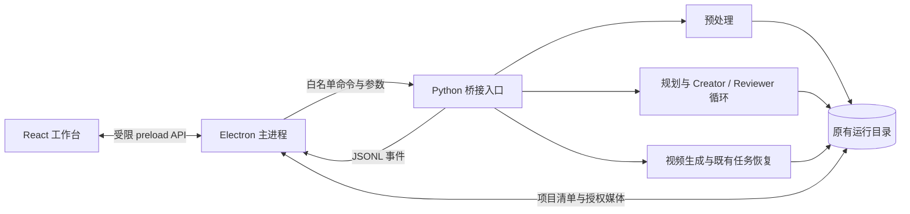

## Context

动机与范围见 [proposal.md](proposal.md)。现有 `cli.py` 调用预处理、规划、生成三个业务阶段，`config.py` 读取本地配置，Pydantic 数据结构与运行目录保存输入快照、审查和远端任务。CLI 的人类可读输出不适合作为界面协议。

参考 Manga2Animate 的三阶段流程与 Creator／Reviewer 循环继续由 Python 承担。参考版本沿用已记录提交 `29543daacbf58c609c360bad840649b0de6b4866`；客户端是新增入口，参考项目中可复用的业务机制通过现有引擎使用，不复制到 TypeScript。

用户本次明确新增前端，替代早期“无前端”阶段范围；“不搭建 Web 服务”的约束仍成立。本变更独立于尚未结束的 `implement-mangaweaver-mvp`，不宣称解决其全部待办。

## Goals / Non-Goals

**Goals:**

- 用一个桌面窗口完成素材检查、镜头与关键画面审查、阶段反馈、任务恢复及结果预览。
- 复用当前数据和业务入口，新增薄桥接，CLI 保持可用。
- 首版在当前 macOS 环境运行并产出可启动的未签名应用，连接用户已有 Python 环境和 FFmpeg。

**Non-Goals:**

- 不重写 Agent、不改善生成算法、不引入新的付费实验，不将整图参考实验顺带产品化。
- 不做完整剪辑器、帧级多轨时间线、多人协作、数据库、HTTP 服务、后台守护进程或插件系统。
- 不在首版捆绑 Python、MAGI 权重和 FFmpeg，不承诺 Windows／Linux 安装包、签名、公证或自动更新。

## Decisions

### 1. Electron 桌面壳 + React 工作台

使用 Electron、React、TypeScript、Vite；Tailwind CSS 与 shadcn/ui 只承担样式和基础控件。相比 Tauri，避免增加 Rust 与 sidecar 打包链；相比 Python 内嵌 WebView，优先获得一致的媒体播放、文件对话框和前端开发体验。接受 Electron 包体积较大的代价。

界面布局采用左侧项目／漫画页，中间素材或镜头内容，右侧详情／审查；顶部提供“素材、规划、生成、结果”阶段导航，底部按需展开运行日志。镜头顺序先使用简单列表和顺序／时长摘要，不引入专业剪辑时间线。素材编辑首版仅支持矩形裁图、顺序、对白与说话人校正。

建议的最小目录边界如下，实施时按实际职责建文件，不预建空模块：

```text
desktop/
  package.json
  electron/
    main.ts                 # 窗口、文件选择、本地媒体、IPC 注册
    preload.ts              # 暴露有限桌面 API
    engine.ts               # Python 进程、JSONL、运行互斥
  src/
    App.tsx
    components/             # 实际需要的共用控件
    features/
      project/              # 项目与来源编辑
      planning/             # 镜头、关键画面与反馈
      generation/           # 任务与恢复
      review/               # 媒体与审查
    lib/bridge.ts           # 类型化调用与事件订阅
src/mangaweaver/
  desktop.py                # Python 命令适配与脱敏读取
  events.py                 # 小型事件定义／输出工具
  ...                       # 现有三阶段和客户端
```

Electron/Vite 配置、样式和入口文件随工程创建；不额外分仓、建 monorepo 编排器或拆通用 SDK。

### 2. IPC + 一次操作一个 Python 子进程



主进程通过参数数组 `spawn` 配置的 Python 可执行文件，调用 `python -m mangaweaver.desktop`；不使用 shell 拼接。每个操作读取一条结构化请求，完成后退出，避免常驻服务和跨进程调度框架。只读查询可短进程执行，同一运行最多一个修改进程。

请求包含 `request_id`、白名单 `command`、项目／运行引用及命令参数。命令覆盖环境检查、运行读取、来源保存、预处理、规划、反馈修订、生成 dry-run、正式生成和恢复；由 Python 校验参数，映射至现有业务函数。若 CLI 中存在必须复用的输入／配置记录逻辑，仅抽取直接共享函数，避免桌面绕过快照和签名校验。

stdout 仅输出协议版本 1 的逐行 JSON；事件统一含 `request_id`、运行引用、事件类型、阶段及数据。最少类型为 `started`、`stage`、`artifact`、`completed`、`failed`，远端任务变化作为阶段数据携带既有任务 ID。stderr 保存脱敏诊断；普通日志不混入协议。解析需处理分块／半行及退出码，无成功终止事件的异常退出视为失败。

在实际阶段边界增加可选事件回调，CLI 默认无回调；不靠解析日志推测完成。阶段未提供细粒度进度时显示进行中和当前任务数量，不估算百分比。界面重开读取既有持久化文件，不建事件库或事件重放服务。

### 3. 项目清单只索引，运行文件仍是业务事实来源

项目包含 `project.json`、导入的 `sources/` 和新运行 `runs/`。`project.json` 仅记录格式版本、名称、来源版本与运行引用；项目内路径优先相对存储。已有 `results/...` 可以外部引用，不复制大型媒体。迁移项目后外部路径失效时提示重新定位。

新导入的页面复制到项目素材目录；编辑保存新的来源子目录、裁图和 `SourceManifest`，使用现有来源校验。运行关联来源后不原地修改，来源变更使用新运行。自动分格依赖缺失时明确报错；用户也可显式选择手工分格，不做静默回退。首版接收漫画页图片和已有来源清单，不新增 MOBI／EPUB 解包器。

来源脚本、镜头、演出、故事板、审查和视频任务仍读取原有 JSON。桌面视图针对正式格式作少量映射，不重建业务数据协议。历史实验只提取已有媒体和明确的审查／报告字段；无法识别的内容显示文件清单，不为了兼容所有实验建立插件加载器。

### 4. 用户编辑作为来源修订或阶段反馈

素材校正与规划反馈是两种操作：前者保存新来源；后者调用已有 `--from-stage` / `--feedback` 对应逻辑。镜头列表首版只读查看，节奏、镜头关系、台词、关键画面的问题由用户以文本提交给对应阶段。无需承诺尚不存在的直接拖改已批准镜头表功能。

同一运行的阶段修订沿用已有 revision 记录和产物签名；展示修订前后结果，不覆盖已批准输入。若已有视频任务，修改生成输入必须新建运行；旧任务继续绑定旧计划，避免改写任务对应的输入。是否可恢复、可生成、审查是否通过均由引擎校验，页面禁用按钮只是展示。

### 5. 恢复围绕原有远端任务记录

开始操作前检查同一运行是否被本客户端或 CLI 占用，采用原子运行锁记录 PID 与操作信息，不建队列。锁过期需核实进程已结束；CLI 与桌面共用这项最小保护。已有任务 ID 的恢复只查询／下载；未知是否提交的记录维持引擎阻塞，不自动重交。

停止先请求本地进程中断，必要时终止本地子进程；依赖现有“提交后及时持久化任务 ID”机制，不承诺远端取消。活动任务时退出应用给出“继续运行／停止后退出”的明确选择。无常驻后台模式。

配置通过用户选择的 Python、FFmpeg 与 `.env` 路径读取；界面只接收经过白名单筛选的有效模型／渠道／分辨率及凭据是否存在，不读取或回显密钥，不提供通用 `.env` 浏览器。依赖缺失不阻止历史媒体查看，但阻止相应执行。

MiniMax 能力检查复用现有适配边界；默认 Lite / 480P 无法满足时阻止提交。以前标准 H3 / 768P 实验的授权不转换为新的运行默认。正式 `first_frame` / `first_last_frame` 路线继续按引擎支持提供；`reference_image` 历史实验仅供查看。

### 6. 本地媒体预览与文件导出

Electron 使用 `contextIsolation`，关闭 renderer Node 集成，通过 preload 暴露类型化有限方法。应用页面仅加载本地打包资源（开发时为本地 Vite）；禁止任意导航与不受控新窗口。

媒体采用专用本地协议，以主进程维护的授权文件标识映射真实路径，规范化并检查 realpath，防止目录穿越和符号链接越界。仅授权已打开项目、已挂接运行、清单明确引用的来源媒体或用户选择文件；不能通过页面任意传绝对路径读取。支持 MIME 与 Range 请求供视频拖动定位，不把模型服务 URL 或密钥交给 renderer。

播放使用浏览器原生视频控件，保留原生音轨；独立选择 clean／字幕版，已有烧录版不再重复叠字幕。对白来源与规划译文同实际听辨字幕分别标识。不构建 ASR、TTS 或混音系统。导出通过保存对话框复制现有视频／SRT；拒绝结果仍可导出为明确标识的预览，不能改变审查状态。

## Risks / Trade-offs

- [Python／FFmpeg 环境不便携] → 首版提供依赖检查、可执行路径设置和当前 macOS 启动说明；未签名应用依赖本地环境，不包装为开箱即用安装器。
- [旧运行格式与独立实验不一致] → 正式格式提供完整工作台，实验只读查看；字段缺失明确提示，不猜测审查通过。
- [桌面与 CLI 同时写目录] → 共用运行锁与已有快照校验；不以界面内互斥代替跨入口保护。
- [进程中断发生在远端提交窗口] → 保存并展示不确定状态，继续沿用引擎禁止盲目重交的机制。
- [引擎尚有生成质量和审查可靠性问题] → 并列显示来源、模型审查和已有人工复核；本变更只改善检查和反馈入口。
- [Electron 依赖增加与媒体内存开销] → 按需加载本地缩略图和选中媒体，不把全部原图与视频转成 base64 注入页面。

## Migration Plan

1. 核实参考版本、当前 CLI／运行产物与视频能力检查位置，实施时同步根目录说明中新增桌面入口的阶段范围。
2. 先交付只读打开已有运行和媒体预览，再接入桥接、来源编辑、规划反馈与任务恢复。
3. 使用已有入间漫画运行验证多格来源、拒绝预览及整图参考实验查看；用 dry-run 验证生成任务，不新增付费调用。
4. 在当前 macOS 产出并启动未签名应用，验证配置 Python 与 FFmpeg 后可读已有项目；提供开发启动、构建及环境配置说明。
5. 旧运行无需批量迁移；停止使用桌面应用即可回到 CLI，新增项目清单不改变原有运行格式。恢复使用 CLI 前确认桌面子进程已退出。
